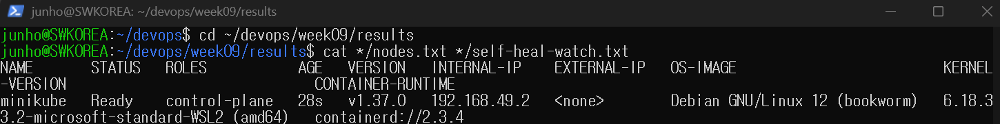
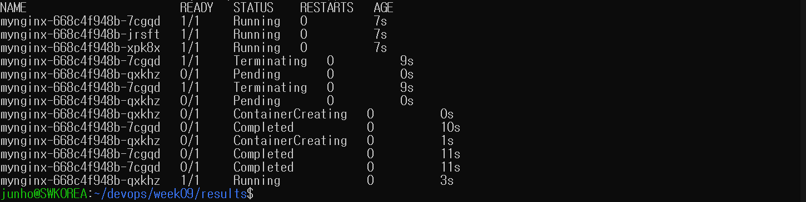
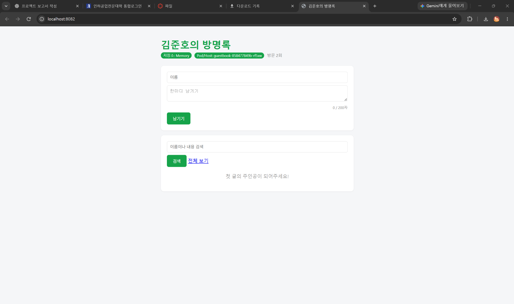

# 9주차 - 쿠버네티스

교안: 08. 쿠버네티스 (2026-2 / 9주차)

## 배운 내용

kubectl은 클러스터에 명령을 보내는 도구이고, minikube는 내 컴퓨터에 실습용 클러스터를 만드는 도구다.

Pod는 컨테이너를 담는 최소 배포 단위다. 이번 실습에서는 Pod 하나에 컨테이너 하나를 실행한다.

`kubectl run`으로 만든 Pod는 Pod 자체를 지우면 다시 생기지 않는다. Deployment는 ReplicaSet을 통해 정해진 개수의 Pod를 유지한다. 관리하던 Pod가 지워지면 새 이름의 Pod가 만들어진다. 컨테이너 재시작과 Pod 재생성은 다르다.

선언형은 원하는 상태를 정하고 그 상태에 맞추도록 맡기는 방식이다. 에어컨 온도를 정해 두면 알아서 맞추는 것과 비슷하다.

## 실습 순서

1. kubectl과 minikube를 설치하고 노드의 Ready 상태 확인
2. nginx Pod 실행, 로그 확인, port-forward 접속
3. Deployment로 Pod 3개 실행 후 하나를 삭제하고 새 Pod 생성 확인
4. Pod 수를 5개와 2개로 변경
5. 내 방명록을 쿠버네티스에서 실행하고 Pod/Host 확인

직접 실행할 명령은 [COMMANDS.md](COMMANDS.md)에 정리했다.

## 현재 실행 기록

아래 자동 실행 기록은 이 노트북에서 실제로 실행한 명령의 출력이다. 브라우저 화면 캡처와 GitHub 반영은 별도로 확인한다.

- [x] 사용한 도구와 `kubectl get nodes`의 Ready 결과
- [x] `kubectl get pods -w`의 Pod 삭제 및 재생성 결과 (텍스트 기록)
- [x] 방명록 브라우저 화면과 Pod/Host (첨부 파일)
GitHub 업로드와 week09 태그는 업로드 명령의 마지막 검증 결과로 확인한다.

## 이번 실행 보조 파일에서 달라지는 부분

교안 49쪽은 GHCR에 올린 자기 이미지를 사용한다. 이 준비본은 기존 `guestbook/` 소스로 `guestbook:week09`를 만들고, 50쪽의 `minikube image load` 방식을 응용해 로컬 이미지를 노드에 넣는다. GHCR 배포를 완료했다는 뜻은 아니다.

기존 Compose의 8080 포트와 gbv2의 8081 포트를 건드리지 않도록 실행 보조 파일에서는 8082 포트를 사용한다. Redis를 새로 구성하지 않으므로 이번 쿠버네티스 방명록은 Memory 모드다.

자동 실행용 설치 확인, 준비 상태 대기, 로그 저장은 반복 입력을 줄이기 위한 보조 처리다. 교안에서 배운 새 기능으로 적지 않는다.

## port-forward와 데이터

Deployment는 Pod 개수를 복구하지만, 사용자가 열어 둔 port-forward 연결까지 복구하지는 않는다. 연결된 Pod를 지우면 새 Pod를 확인한 뒤 port-forward를 다시 실행해야 한다. Memory에 있던 글도 새 Pod로 이어지지 않는다.

## 캡처와 제출

`images/`에는 직접 실행한 화면만 넣는다.

- `01-nodes.png`: 사용한 도구와 노드 Ready 상태
- `02-self-heal.png`: Pod 삭제 후 새 Pod가 생긴 관찰 결과
- `03-guestbook.png`: 브라우저의 방명록과 Pod/Host

실행 보조 파일을 쓰면 실제 터미널 출력은 `results/실행시각/`에 저장되고, README 아래에 실행 기록이 추가된다. 브라우저 캡처를 대신 만들어 넣지는 않는다.

실행과 캡처를 마친 뒤 교안 67쪽 순서로 반영한다.

```bash
cd ~/devops
git add week09
git diff --cached --stat
git commit -m "week09: 쿠버네티스 첫 배포"
git tag week09
git push origin main
git push origin week09
```

이미 같은 태그가 있으면 덮어쓰지 말고 먼저 확인한다.

참고 쪽: 설치 9~14쪽, Pod 31~40쪽, 자가 치유 42~47쪽, 방명록 49~56쪽, 기록 67쪽.

## 자동 실행 기록

실행 시각: 2026-11-03T23:20:13+09:00

사용 도구: WSL/Linux, Docker, kubectl, minikube (Docker 드라이버)

이미지: `guestbook:week09` (로컬 빌드 후 minikube에 로드)

접속 주소: `http://localhost:8082`

브라우저를 대신 조작한 것은 아니며, HTTP 요청으로 실제 응답과 Pod 이름 `guestbook-858477849b-rf5xw`를 확인했다.

### 설치와 노드

#### 도구 버전

```text
2026-11-03T23:17:44+09:00
Client:
 Version:           29.8.0
 API version:       1.56
 Go version:        go1.26.8
 Git commit:        88096ef
 Built:             Thu Sep  3 21:49:51 2026
 OS/Arch:           linux/amd64
 Context:           default

Server: Docker Desktop 4.91.0 (239619)
 Engine:
  Version:          29.8.0
  API version:      1.56 (minimum version 1.40)
  Go version:       go1.26.8
  Git commit:       3ce5872
  Built:            Thu Sep  3 21:51:20 2026
  OS/Arch:          linux/amd64
  Experimental:     false
 containerd:
  Version:          v2.3.4
  GitCommit:        db8809540e1a7a9da5d518876894933ff55692ab
 runc:
  Version:          1.4.3
  GitCommit:        v1.4.3-0-gbb14dabe
 docker-init:
  Version:          0.19.0
  GitCommit:        de40ad0
Client Version: v1.36.1
Kustomize Version: v5.8.1
minikube version: v1.39.0
commit: 7a9f6a841470a207de8cf4bafcccee0969d8ba10
```

#### 노드 상태

```text
NAME       STATUS   ROLES           AGE   VERSION   INTERNAL-IP    EXTERNAL-IP   OS-IMAGE                         KERNEL-VERSION                              CONTAINER-RUNTIME
minikube   Ready    control-plane   28s   v1.37.0   192.168.49.2   <none>        Debian GNU/Linux 12 (bookworm)   6.18.33.2-microsoft-standard-WSL2 (amd64)   containerd://2.3.4
```

#### 자가 치유: 삭제 전

```text
NAME                       READY   STATUS    RESTARTS   AGE   IP           NODE       NOMINATED NODE   READINESS GATES
mynginx-668c4f948b-7cgqd   1/1     Running   0          7s    10.244.0.5   minikube   <none>           <none>
mynginx-668c4f948b-jrsft   1/1     Running   0          7s    10.244.0.4   minikube   <none>           <none>
mynginx-668c4f948b-xpk8x   1/1     Running   0          7s    10.244.0.6   minikube   <none>           <none>
```

#### 자가 치유: 관찰

```text
NAME                       READY   STATUS    RESTARTS   AGE
mynginx-668c4f948b-7cgqd   1/1     Running   0          7s
mynginx-668c4f948b-jrsft   1/1     Running   0          7s
mynginx-668c4f948b-xpk8x   1/1     Running   0          7s
mynginx-668c4f948b-7cgqd   1/1     Terminating   0          9s
mynginx-668c4f948b-qxkhz   0/1     Pending       0          0s
mynginx-668c4f948b-7cgqd   1/1     Terminating   0          9s
mynginx-668c4f948b-qxkhz   0/1     Pending       0          0s
mynginx-668c4f948b-qxkhz   0/1     ContainerCreating   0          0s
mynginx-668c4f948b-7cgqd   0/1     Completed           0          10s
mynginx-668c4f948b-qxkhz   0/1     ContainerCreating   0          1s
mynginx-668c4f948b-7cgqd   0/1     Completed           0          11s
mynginx-668c4f948b-7cgqd   0/1     Completed           0          11s
mynginx-668c4f948b-qxkhz   1/1     Running             0          3s
```

#### 자가 치유: 삭제 후

```text
NAME                       READY   STATUS    RESTARTS   AGE   IP           NODE       NOMINATED NODE   READINESS GATES
mynginx-668c4f948b-jrsft   1/1     Running   0          15s   10.244.0.4   minikube   <none>           <none>
mynginx-668c4f948b-qxkhz   1/1     Running   0          6s    10.244.0.7   minikube   <none>           <none>
mynginx-668c4f948b-xpk8x   1/1     Running   0          15s   10.244.0.6   minikube   <none>           <none>
```

#### 방명록 Deployment

```text
NAME        READY   UP-TO-DATE   AVAILABLE   AGE
guestbook   1/1     1            1           3s
```

#### 방명록 Pod

```text
NAME                         READY   STATUS    RESTARTS   AGE   IP            NODE       NOMINATED NODE   READINESS GATES
guestbook-858477849b-rf5xw   1/1     Running   0          3s    10.244.0.10   minikube   <none>           <none>
```

삭제한 Pod: `mynginx-668c4f948b-7cgqd`. 새 Pod: `mynginx-668c4f948b-qxkhz`.

Pod 이름이 달라졌고, 준비된 Pod가 다시 3개가 된 것을 확인했다.

전체 명령 출력: [results/20261103-231744-1023/run.log](results/20261103-231744-1023/run.log)

방명록 실제 HTTP 응답: [results/20261103-231744-1023/guestbook.html](results/20261103-231744-1023/guestbook.html)

### 직접 캡처할 화면






