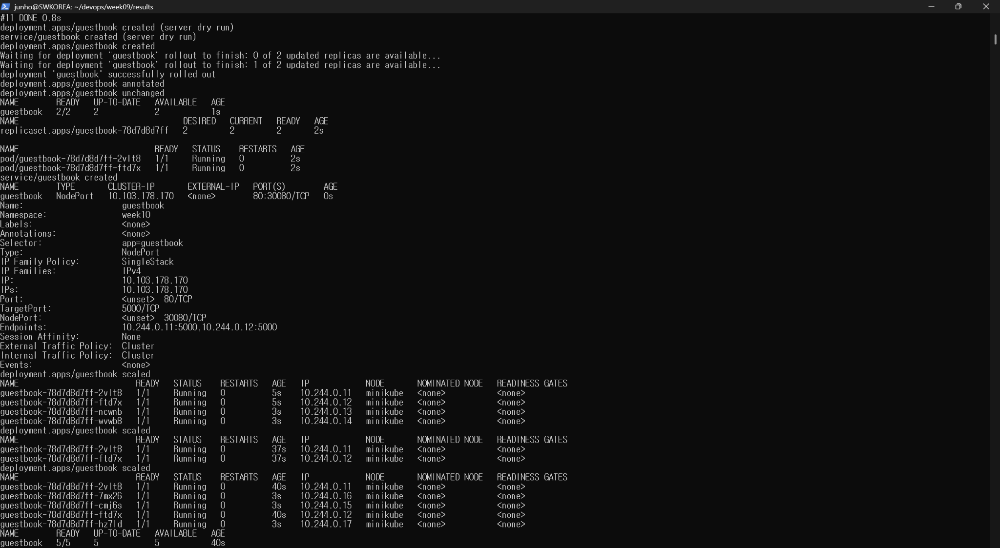
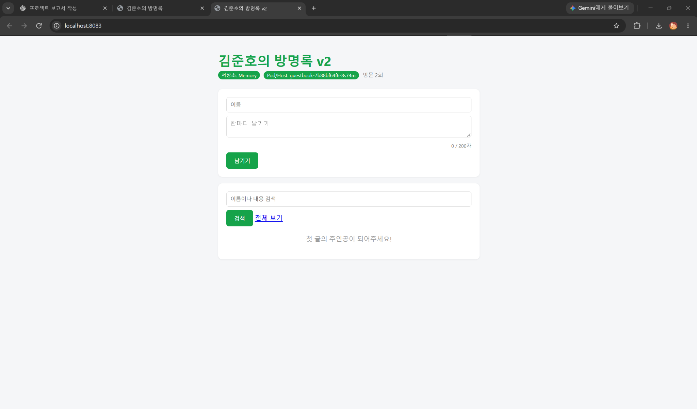
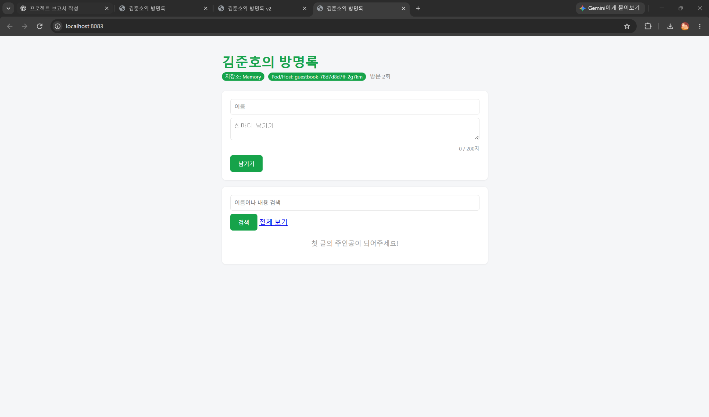
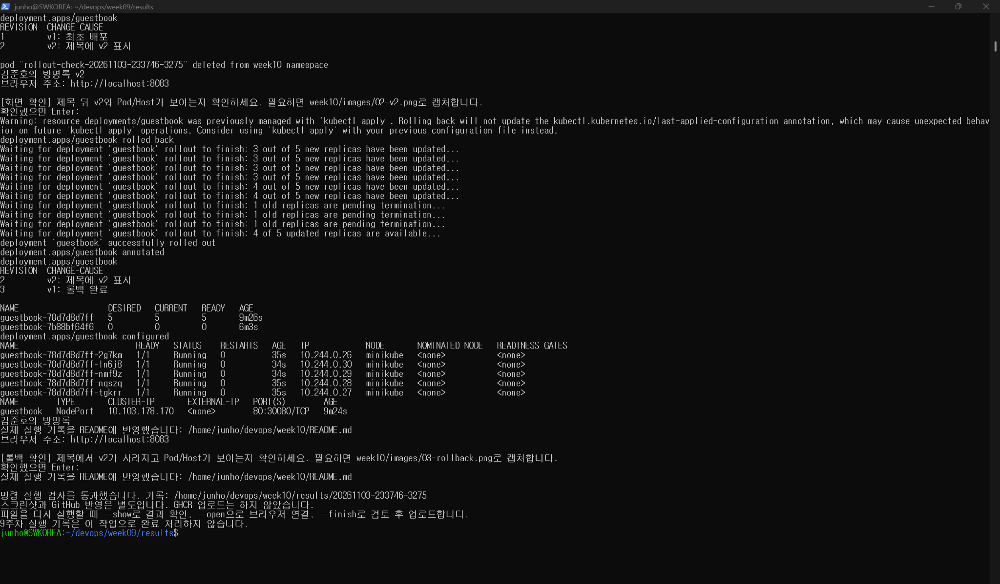

# 10주차 - 쿠버네티스 배포와 서비스

교안: 09. 쿠버네티스 배포와 서비스 (2026-2 / 10주차)

## 배운 내용

Deployment에 원하는 Pod 개수와 이미지를 정한다. Deployment가 ReplicaSet을 만들고, ReplicaSet이 Pod 개수를 유지한다.

Pod가 바뀌면 IP도 바뀔 수 있다. Service는 Pod 앞에서 대표 주소 역할을 한다. 이번 설정에서는 Deployment의 selector, Pod의 label, Service의 selector를 모두 `app: guestbook`으로 맞춘다.

`kubectl apply`는 YAML에 적힌 상태를 적용한다. 같은 파일을 다시 적용해도 변경이 없으면 unchanged가 나온다. 명령으로 개수를 늘렸어도 YAML을 다시 적용하면 파일에 적힌 개수로 맞춰진다.

롤링 업데이트는 새 ReplicaSet을 만들고 Pod를 차례대로 교체하는 방식이다. `rollout history`로 기록을 보고, `rollout undo`로 이전 설정으로 되돌릴 수 있다.

## 파일

- `../guestbook/k8s/deployment.yaml`: 방명록 Deployment
- `../guestbook/k8s/service.yaml`: NodePort Service
- `COMMANDS.md`: 교안 순서와 확인 명령
- `WHY.md`: 「10. 왜 굳이」의 도구 사용 이유 정리
- `references/`: 제공받은 YAML 원본

제공된 Service 설정은 그대로 사용한다. 서비스 port는 80, targetPort는 5000, nodePort는 30080이다. Deployment의 컨테이너 이름은 web이다.

## 과제 확인 항목

교안 60쪽 기준이다. 아래 칸은 실제 실행 결과가 있을 때만 바꾼다.

- [x] replicas 5개와 Pod 실행 상태 기록
- [x] 서비스 요청에 서로 다른 Pod hostname이 나온 기록
- [x] Pod 하나 삭제 후 새 Pod가 만들어진 기록
- [x] v1에서 v2로 롤링 업데이트한 기록과 rollout history
- [x] v1으로 롤백한 기록
- [x] Pod 5개 화면 캡처 첨부
GitHub 커밋·푸시와 week10 태그는 마지막 업로드 단계에서 별도로 확인한다.

## 준비본과 교안의 차이

교안의 원래 파일 이름과 Deployment/Service 구조는 유지했다. 실행 편의를 위한 아래 변경은 별도로 적용했다.

1. 기존 9주차 작업과 겹치지 않도록 minikube의 `week10` 네임스페이스를 사용한다. 명령에는 `--context=minikube -n week10`을 붙인다. default의 리소스와 Docker Compose는 지우지 않는다.
2. GHCR 업로드를 했다고 가정하지 않는다. 기존 방명록 소스를 로컬에서 빌드하고, 교안 43쪽의 `minikube image load` 방식으로 노드에 넣는다. 이미지 태그는 `guestbook:week10-v1-실행번호`, `guestbook:week10-v2-실행번호`다. 이것은 GHCR push 결과가 아니다.
3. v2는 기존 소스의 임시 복사본에서 제목 뒤에 v2를 붙여 만든다. 기존 app.py, templates/index.html, Dockerfile과 Compose 설정은 수정하지 않는다. 실제 차이는 실행 기록의 `v2-title.diff`에 남긴다.
4. 처음에는 교안대로 2개로 시작한다. 4개와 2개 변경을 거친 뒤 과제 조건인 5개로 늘린다. 마지막 YAML은 5개, v1으로 남겨 롤백 후 상태와 일치시킨다.
5. 브라우저는 기존 8080·8081·8082와 겹치지 않도록 `port-forward`의 8083을 사용한다. 이 연결은 Pod 하나로 연결되므로 로드밸런싱 증거로 쓰지 않는다. 요청 분산은 교안 40쪽처럼 클러스터 내부 검사 Pod에서 `http://guestbook/healthz`로 요청한 결과를 기록한다.
6. 설치 확인, 대기, 로그 저장, 캡처 안내는 반복 입력을 줄이기 위한 실행 보조 처리다. 교안에 있는 앱 기능으로 설명하지 않는다.

아래는 이 노트북에서 명령과 HTTP 응답 검사를 통과한 실행 기록이다. 캡처와 GitHub 업로드는 별도로 확인한다.

## 데이터와 업데이트의 한계

이번 교안에서는 Redis를 연결하지 않으므로 저장소는 Memory다. 다른 Pod로 요청이 가면 글이 다르게 보일 수 있고, Pod를 지우면 그 Pod의 메모리 데이터는 이어지지 않는다.

Pod 복제와 서비스 무중단은 같은 뜻이 아니다. 제공된 YAML에는 readinessProbe가 없다. 따라서 롤링 업데이트 중 실패 응답이 있었는지는 관찰 로그를 확인해야 하며, 성공 응답 몇 번으로 항상 무중단이라고 결론내리지 않는다. 준비 상태 검사는 다음 수업에서 더 다루는 내용이다.

## 기록과 제출

스크립트는 실제 명령 출력을 `results/실행번호/`에 저장한다. 화면 캡처는 사용자가 `images/`에 넣는다. 교안 출력 예시나 별도의 가상 결과를 실습 증빙으로 사용하지 않는다.

- `images/01-pods5.png`: 필수인 Pod 5개 실행 화면
- `images/02-v2.png`: 선택, v2 제목과 Pod/Host
- `images/03-rollback.png`: 선택, 롤백 후 제목과 Pod/Host

모든 명령 확인과 필수 캡처 후 다운로드한 실행 파일의 `--finish`를 사용하면 관련 파일만 커밋하고 week10 태그와 함께 올린다. 기존 태그를 덮어쓰지 않는다. GitHub 업로드가 실패하면 오류를 확인해야 한다.

참고: 배포와 서비스 교안 21~36쪽, 스케일링 39~42쪽, 업데이트·롤백 43~58쪽, 과제 60쪽, Memory 및 다음 수업 35·63쪽. 「왜 굳이」 11쪽의 무중단 주의 사항.

## 실제 실행 기록

실행 시각: 2026-11-03T23:47:50+09:00

환경: minikube, namespace=week10

v1 이미지: `guestbook:week10-v1-20261103-233746-3275`
v2 이미지: `guestbook:week10-v2-20261103-233746-3275`

로컬 빌드 후 minikube에 넣었다. GHCR에 이미지를 올린 기록은 아니다. 기존 방명록 소스는 변경하지 않았다.

### 노드 Ready

```text
NAME       STATUS   ROLES           AGE   VERSION   INTERNAL-IP    EXTERNAL-IP   OS-IMAGE                         KERNEL-VERSION                              CONTAINER-RUNTIME
minikube   Ready    control-plane   19m   v1.37.0   192.168.49.2   <none>        Debian GNU/Linux 12 (bookworm)   6.18.33.2-microsoft-standard-WSL2 (amd64)   containerd://2.3.4
```

### Pod 5개

```text
NAME                         READY   STATUS    RESTARTS   AGE   IP            NODE       NOMINATED NODE   READINESS GATES
guestbook-78d7d8d7ff-2vlt8   1/1     Running   0          40s   10.244.0.11   minikube   <none>           <none>
guestbook-78d7d8d7ff-7mx26   1/1     Running   0          3s    10.244.0.16   minikube   <none>           <none>
guestbook-78d7d8d7ff-cmj6s   1/1     Running   0          3s    10.244.0.15   minikube   <none>           <none>
guestbook-78d7d8d7ff-ftd7x   1/1     Running   0          40s   10.244.0.12   minikube   <none>           <none>
guestbook-78d7d8d7ff-hz7ld   1/1     Running   0          3s    10.244.0.17   minikube   <none>           <none>
```

### Service

```text
NAME        TYPE       CLUSTER-IP       EXTERNAL-IP   PORT(S)        AGE
guestbook   NodePort   10.103.178.170   <none>        80:30080/TCP   0s
```

### 서로 다른 Pod 응답

```text
{"hostname":"guestbook-78d7d8d7ff-7mx26","status":"ok"}

{"hostname":"guestbook-78d7d8d7ff-cmj6s","status":"ok"}

{"hostname":"guestbook-78d7d8d7ff-2vlt8","status":"ok"}

{"hostname":"guestbook-78d7d8d7ff-ftd7x","status":"ok"}

{"hostname":"guestbook-78d7d8d7ff-hz7ld","status":"ok"}

{"hostname":"guestbook-78d7d8d7ff-2vlt8","status":"ok"}

All commands and output from this session will be recorded in container logs, including credentials and sensitive information passed through the command prompt.
If you don't see a command prompt, try pressing enter.
pod "lb-check-20261103-233746-3275-1" deleted from week10 namespace
```

### 삭제 전

```text
NAME                         READY   STATUS    RESTARTS   AGE     IP            NODE       NOMINATED NODE   READINESS GATES
guestbook-78d7d8d7ff-2vlt8   1/1     Running   0          2m43s   10.244.0.11   minikube   <none>           <none>
guestbook-78d7d8d7ff-7mx26   1/1     Running   0          2m6s    10.244.0.16   minikube   <none>           <none>
guestbook-78d7d8d7ff-cmj6s   1/1     Running   0          2m6s    10.244.0.15   minikube   <none>           <none>
guestbook-78d7d8d7ff-ftd7x   1/1     Running   0          2m43s   10.244.0.12   minikube   <none>           <none>
guestbook-78d7d8d7ff-hz7ld   1/1     Running   0          2m6s    10.244.0.17   minikube   <none>           <none>
```

### Pod 삭제와 재생성 관찰

```text
NAME                         READY   STATUS    RESTARTS   AGE
guestbook-78d7d8d7ff-2vlt8   1/1     Running   0          2m43s
guestbook-78d7d8d7ff-7mx26   1/1     Running   0          2m6s
guestbook-78d7d8d7ff-cmj6s   1/1     Running   0          2m6s
guestbook-78d7d8d7ff-ftd7x   1/1     Running   0          2m43s
guestbook-78d7d8d7ff-hz7ld   1/1     Running   0          2m6s
guestbook-78d7d8d7ff-2vlt8   1/1     Terminating   0          2m45s
guestbook-78d7d8d7ff-pvgh7   0/1     Pending       0          0s
guestbook-78d7d8d7ff-2vlt8   1/1     Terminating   0          2m45s
guestbook-78d7d8d7ff-pvgh7   0/1     Pending       0          0s
guestbook-78d7d8d7ff-pvgh7   0/1     ContainerCreating   0          0s
guestbook-78d7d8d7ff-pvgh7   0/1     ContainerCreating   0          1s
guestbook-78d7d8d7ff-pvgh7   1/1     Running             0          1s
guestbook-78d7d8d7ff-2vlt8   0/1     Error               0          3m16s
guestbook-78d7d8d7ff-2vlt8   0/1     Error               0          3m16s
guestbook-78d7d8d7ff-2vlt8   0/1     Error               0          3m16s
```

### 삭제 후

```text
NAME                         READY   STATUS    RESTARTS   AGE     IP            NODE       NOMINATED NODE   READINESS GATES
guestbook-78d7d8d7ff-7mx26   1/1     Running   0          2m41s   10.244.0.16   minikube   <none>           <none>
guestbook-78d7d8d7ff-cmj6s   1/1     Running   0          2m41s   10.244.0.15   minikube   <none>           <none>
guestbook-78d7d8d7ff-ftd7x   1/1     Running   0          3m18s   10.244.0.12   minikube   <none>           <none>
guestbook-78d7d8d7ff-hz7ld   1/1     Running   0          2m41s   10.244.0.17   minikube   <none>           <none>
guestbook-78d7d8d7ff-pvgh7   1/1     Running   0          33s     10.244.0.19   minikube   <none>           <none>
```

### v2 업데이트 기록

```text
deployment.apps/guestbook 
REVISION  CHANGE-CAUSE
1         v1: 최초 배포
2         v2: 제목에 v2 표시
```

### v2 ReplicaSet

```text
NAME                   DESIRED   CURRENT   READY   AGE
guestbook-78d7d8d7ff   0         0         0       4m
guestbook-7b88bf64f6   5         5         5       37s
```

### 롤백 결과

```text
Waiting for deployment "guestbook" rollout to finish: 3 out of 5 new replicas have been updated...
Waiting for deployment "guestbook" rollout to finish: 3 out of 5 new replicas have been updated...
Waiting for deployment "guestbook" rollout to finish: 3 out of 5 new replicas have been updated...
Waiting for deployment "guestbook" rollout to finish: 3 out of 5 new replicas have been updated...
Waiting for deployment "guestbook" rollout to finish: 4 out of 5 new replicas have been updated...
Waiting for deployment "guestbook" rollout to finish: 4 out of 5 new replicas have been updated...
Waiting for deployment "guestbook" rollout to finish: 1 old replicas are pending termination...
Waiting for deployment "guestbook" rollout to finish: 1 old replicas are pending termination...
Waiting for deployment "guestbook" rollout to finish: 1 old replicas are pending termination...
Waiting for deployment "guestbook" rollout to finish: 4 of 5 updated replicas are available...
deployment "guestbook" successfully rolled out
```

### 롤백 후 기록

```text
deployment.apps/guestbook 
REVISION  CHANGE-CAUSE
2         v2: 제목에 v2 표시
3         v1: 롤백 완료
```

### 롤백 후 ReplicaSet

```text
NAME                   DESIRED   CURRENT   READY   AGE
guestbook-78d7d8d7ff   5         5         5       9m26s
guestbook-7b88bf64f6   0         0         0       6m3s
```

삭제한 Pod: `guestbook-78d7d8d7ff-2vlt8`. 새로 생긴 Pod: `guestbook-78d7d8d7ff-pvgh7`.

서비스 응답에서 서로 다른 hostname 5개를 확인했다.

REVISION은 v1 1, v2 2, 롤백 3로 기록되었다.

### 업데이트 중 HTTP 관찰

관찰 로그의 HTTP 200 응답: 41회.
다른 HTTP 상태: []. 연결 오류 문구: 0줄.

이 수치는 기록한 구간에서 관찰한 결과다. 모든 요청의 무중단을 보장하는 결과로 해석하지 않는다.
원문: [results/20261103-233746-3275/rollout-http.txt](results/20261103-233746-3275/rollout-http.txt)

### 화면 확인과 첨부

브라우저 확인 주소: `http://localhost:8083`. port-forward가 실행 중이어야 열린다.
HTTP 응답으로 v2 제목 및 롤백 후 제목과 Pod/Host를 검사했다. 아래 HTML 파일은 실제 응답이며 브라우저 스크린샷은 아니다.
[v2 응답](results/20261103-233746-3275/browser-v2.html) / [롤백 응답](results/20261103-233746-3275/browser-rollback.html)







전체 실행 로그: [results/20261103-233746-3275/run.log](results/20261103-233746-3275/run.log)
v1·v2 제목 변경: [results/20261103-233746-3275/v2-title.diff](results/20261103-233746-3275/v2-title.diff)

9주차 기록과 캡처는 별도의 week09 과제다. 이번 실행으로 9주차를 완료 처리하지 않는다.

### 롤백 후 터미널 결과


